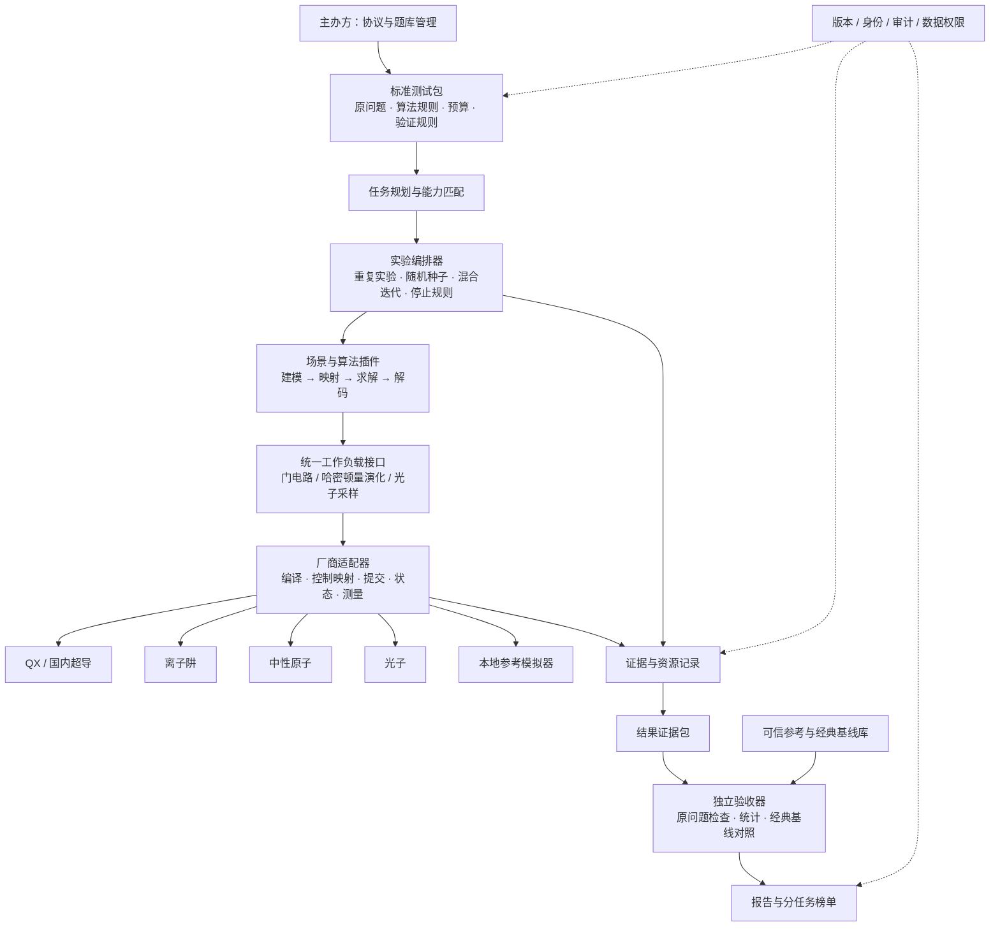

# 量子计算测试工具链整体框架

> 框架版本 0.5.0 · 工具 QTest 0.5.0 · 2026-11-09  
> 面向：Benchmark 主办方、合作实验室、量子主机厂商、独立复核方  
> 本文定义完整建设框架；第 12 节明确当前原型与正式交付之间的差距。

0.5.0 起**测试执行统一为 Web 管理台单一入口**：不再区分主办方直连与厂商自测两种执行模式（CLI 不再执行测试，仅保留验收与分析命令），并新增 L0 基础能力层的首个基准——镜像电路保真度与最大稳定线路深度（`capability.mirror_fidelity.v1`）。变更调研与方案见 [统一入口与分层指标方案](unified-testing-platform.md)。0.4.0 新增 1D Ising 链材料动力学联调样例：等时连通关联矩阵 C_ij(t) 与结构因子 S(q,t) 的完整重建、精确参考和独立重放（`application.material_dynamics.v1`）。0.3.0 已增加实验室共享 Web 管理台：账号与角色、用例版本、持久任务队列、独立 Worker、执行状态、协作取消、结果下载与综合对比。设计见 [Web 方案](web-management-plan.md)，部署和操作见 [使用说明](web-management.md)。下文的正式题库、设备身份认证与发布服务仍属于完整建设范围。

## 1. 工具链定位

将 Benchmark 建成一套可分发、可接入不同设备、可独立验收的测试工具。主机厂商可以在自己的环境执行同一个标准测试包；主办方也可以通过适配器访问设备。两种方式使用相同的题目、协议版本、实验规则和验收器。

比较对象是“设备 + 控制系统 + 编译器 + 求解器 + 运行配置”的具体系统。超导、离子阱、中性原子和光子通过各自支持的接口接入；按原问题及能力选择可比较任务。**场景算法与计算内核同步建设，不能用哈密顿量模拟或玻色采样内核替代完整应用测试。**

交付形态分为四件：

1. **公共测试工具包**：CLI、任务协议、运行器、采集器、验收器、报告器。
2. **版本化测试套件**：原始问题、实例、求解规则、预算、参考答案或验证方法、计分规则。
3. **厂商适配器 SDK**：接口规范、开发模板、兼容性测试；厂商负责私有控制接口映射。
4. **主办方验收与发布服务**：证据入库、来源核验、复核、榜单版本及复测管理；与设备执行侧分离。

## 2. 总体架构



图中的运行器部署在实验室服务器上，由 Web 管理台的 Worker 调用（0.5.0 起单一入口）。验收器不需要连接被测设备，使用冻结题目和保留的原始证据重新计算结果。任何一方提交的分数仅是待核验声明。

## 3. 工具链模块划分

| 模块 | 主要输入 | 主要输出 | 责任与边界 |
| --- | --- | --- | --- |
| 协议／题库管理 | 场景定义、实验设计 | 版本化 suite、实例哈希 | 主办方冻结规则，保留原始问题及数据划分 |
| 设备画像 | 厂商 SDK、校准快照 | 能力、拓扑、控制范围、资源上限 | 先声明，再通过兼容性测试确认 |
| 任务规划 | suite、设备画像 | 可执行矩阵、预计调用和预算 | 无法表达的任务标为不兼容，并说明原因 |
| 场景建模 | 原始业务／科学问题 | 数学模型、解码规则 | 保留原问题，不能只记录转换后的 QUBO 或电路 |
| 算法控制器 | 模型、固定种子、训练数据 | 电路／演化／采样任务序列 | 覆盖完整训练、优化、测量和最终评估 |
| 映射／编译 | 标准工作负载、设备约束 | 原生电路／控制序列、映射记录 | 记录截断、近似、辅助资源和编译版本 |
| 设备适配器 | 原生任务、请求 ID | 任务 ID、状态、原始观测 | 负责 SDK 和单位转换，不决定评价规则 |
| 实验运行器 | 任务计划 | 执行状态、重复实验结果 | 管理预算、超时、中止、排队、重复与恢复 |
| 证据采集 | 请求、测量、运行事件 | 可追溯的结果包 | 包含失败、丢弃、重试，禁止只保留最好结果 |
| 参考／经典基线 | 同一个原始问题 | 参考值、误差界、经典结果 | 区分验收参考与性能竞争基线 |
| 独立验证器 | 冻结题目、证据包 | 指标、置信信息、异常清单 | 不执行结果包携带的任意代码 |
| 报告／发布 | 经复核的指标和来源 | 实验报告、能力表、分任务榜单 | 保留协议版本、覆盖范围和未完成项 |

映射层具有双重职责：公共实现负责明确的标准编码，厂商实现负责本机编译。所有会影响结果的变换都必须进入实验配置，避免设备间隐藏的算法差异。

## 4. 三类工作负载接口

不把所有硬件强行塞进一个通用电路接口。统一的是生命周期、资源记录和问题验收；执行表示允许不同。

| 接口 | 表达内容 | 主要接入对象 | 适配要求 |
| --- | --- | --- | --- |
| 门模型 | 电路、逻辑比特、测量基、shots | QX、国内超导、离子阱及具备门能力的系统 | 门分解、布局、路由、读出映射、动态控制支持 |
| 哈密顿量演化 | 相互作用、局域项、初态、时间／波形、观测量 | 中性原子优先；其他原生模拟或数字实现 | 核实可实现项、几何、控制带宽、符号和单位 |
| 光子采样 | 输入态、模式变换、探测与采样条件 | 光子系统 | 区分 Fock、GBS、探测器类型、损耗及后选择 |

统一协议中 (\hbar=1\)；门旋转约定 (R_P(\theta)=e^{-i\theta P/2}\)，角度为弧度。比特串第一个字符对应逻辑比特 0。哈密顿量系数和演化时间必须相互匹配；厂商的 MHz、Hz、角频率和实验时间换算要写入映射记录。

原型中的 `analog.evolve.v1` 只表达静态 Ising 模型，不能代表任意 Rydberg 设备都支持；当前没有自动生成 Rydberg 波形或数字 Trotter 分解。正式接入需增加带控制约束的协议和映射器。适配器若不能忠实实现请求，应拒绝并返回原因，不得静默修改模型。

## 5. 测试内容组织

### 5.1 三层套件

| 层级 | 内容 | 工具链中的位置 |
| --- | --- | --- |
| L0 基础与运行能力 | 控制／拓扑／读出、可用率、漂移、提交成功率、各阶段时间 | 设备画像、校准任务、运行器遥测 |
| L1 内核 | 门模型参考电路、哈密顿量演化、Fock／GBS 分开的采样协议 | 内核插件、已知参考、采样检验 |
| L2 场景算法 | 原问题到最终交付结果的完整算法 | 场景插件、混合控制器、解码和原问题验收器 |

L0 的指标按路线定义，不把不同物理意义的门保真度、原子损失率和光子探测效率强行合成。L1 同时检验质量与可扩展规模；L2 评价应用结果和完整资源开销。

### 5.2 首期场景插件目标

| 场景 | 输入 → 输出 | 首选实现 | 原问题验收与经典基线 | 项目地位 |
| --- | --- | --- | --- | --- |
| A1 冲突约束资源选择 | 图 → 可行节点集合 | 门模型 QAOA；原子原生控制 | 原图可行性、目标差距；精确／启发式 MIS | 首期核心 |
| A2 分子基态能量 | 固定分子模型 → 能量及曲线 | VQE 完整混合迭代 | 同模型精确或可靠参考、专业化学基线 | 首期核心 |
| A3 材料动力学 | 自旋模型 → 关联／结构因子轨迹 | 数字／模拟演化 + 观测重建 | 物理量误差、时间网格；ED／张量网络等 | 首期核心 |
| A4 小规模分类 | 冻结训练／验证／测试集 → 预测 | 量子核 + SVM，后续 VQC | 独立测试集指标；经典核、同预算调参和消融 | 首期核心 |
| A5 稠密子图 | 图与 k → k 节点子图 | 可编程 GBS + 经典搜索 | 原图密度、专业搜索、替换量子采样消融 | 光子应用优先候选，按能力准入 |
| A6 振电光谱 | 指定分子模型 → 谱形 | 所需输入态与模式变换的玻色采样 | 谱线／谱形误差、经典谱计算 | 光子应用替代或扩展候选 |

Fock 采样设备不自动获得 GBS 应用资格。若设备只能执行固定采样任务，则执行对应 L1，L2 如实保留缺口。A3 必须产出关联和结构因子等场景结果，不能仅以几个比特的占据数误差宣布完成材料应用测试。

### 5.3 两条比较轨道

- **固定算法轨道**：冻结编码、ansatz、优化器、预算、种子与后处理，只允许协议内的设备编译。适用于归因到系统执行能力的比较。
- **开放应用轨道**：允许厂商选择适配算法，但冻结原问题、数据划分、资源预算、输出格式与验收规则。所有预处理、调参、嵌入和经典后处理的资源使用与耗时均记录并披露。

两条轨道分别排名。不同原生接口可在满足同一应用语义和预算口径时进入开放应用比较；不把算法不同的成绩解释成纯硬件差距。当前可执行原型只支持固定协议重放，开放应用提交及沙箱验收需后续实现。

## 6. 执行流程（0.5.0 起单一入口）

0.5.0 之前版本提供"主办方直连"与"厂商自测回传"两条 CLI 执行路径；0.5.0 起合并为 Web 管理台单一入口，不再以执行模式区分参与方。当前流程：

1. 实验室管理员安装并审核设备适配器插件，在管理台注册设备（密钥与配置只留服务器）。
2. 成员在用例库从协议模板（L0／L1／L2 分层）建用例；创建任务时工具预检能力缺项与预算，输入提交即冻结。
3. 持久队列与单实例 Worker 执行完整实验：预算前置检查、提交前留档、协作式取消；原始请求和测量实时落盘。
4. 任务结束后由独立重放流程按冻结题目重新验收并重新计算指标；异常与失败保留证据并阻塞设备待核实。
5. 复核人可用 CLI `verify/report/compare` 对下载的证据包离线复核算与对比；发布前仍需来源审核。

厂商离线执行并不等于数据来源已可信。签名能够绑定签署方与包内容，也不能独自证明真实硬件执行；还需要任务凭证、见证抽样、随机挑战或复测等机制。历史证据（0.1.0–0.4.0，含 organizer/vendor 模式字段）不作改写，仍可验收与对比。

## 7. 数据合同与证据规范

正式版本建议形成六类独立 schema；原型已实现 suite schema 及其余部分的 Python 校验。

| 对象 | 必要字段 |
| --- | --- |
| TestSuite | suite／协议版本、原问题或其哈希、任务 ID、重复次数、种子、预算、轨道、评价规则 |
| DeviceProfile | 厂商／设备／软硬件版本、接口能力及边界、拓扑／几何、校准、实际运行配置 |
| Workload | 标准任务表示、精度／单位约定、测量规则、shots、种子、编译和映射要求 |
| RunRecord | 运行／请求／厂商任务 ID、时间戳、状态变化、输入和编译产物哈希、异常 |
| Observation | 原始计数或逐样本数据、尝试数／接受数／丢弃原因、资源、校准与后选择说明 |
| VerificationResult | 指标、参考可靠性、置信信息、覆盖与失败、来源等级、验收器版本 |

当前文件布局：

```text
task.zip
  manifest.json             # 文件清单及 SHA-256
  suite.json                # 冻结题目；不包含密钥或可执行代码

run-directory / result.zip
  suite.json
  run.json                  # 运行来源、设备声明、各项目状态与预留资源
  observations/000001.json  # 提交前请求、任务 ID、状态、原始结果、哈希
  observations/000002.json
  ...
  manifest.json             # ZIP 导出时生成
```

结果包里的题目哈希必须与主办方预先保留的题目一致。哈希不是防伪签名：修改结果后重新计算哈希仍可能得到格式自洽的包。当前验证器额外重放控制器并重新算分，以发现请求、训练步骤和指标之间的不一致；来源真实性由外部复核补足。

## 8. 编排、预算与故障处理

实验粒度为 `suite → case → repetition → iteration → job → observation`。VQE、QAOA、分类训练需要保留全部迭代；最终评估使用独立采样，不能拿最好的带噪训练估计冒充最终成绩。

正式状态机应覆盖：准备、能力检查、编译、提交中、排队、运行、结果回收、验证、完成，以及失败、超时、取消、不支持、证据不足。每个阶段具有明确恢复规则。

资源预算包括总尝试 shots、任务调用和全流程墙钟上限，并分别统计量子执行时间与经典处理时间。执行前检查上限，提交前累计请求数量，执行后记录实际测量及作业状态。光子任务以源尝试次数等明确分母统计，不能不断采到足量接受样本后只记录接受数。

原型已经实现调用／shots 的前置检查与提交前预留、协作式墙钟超时、原始记录和取消请求。提交响应丢失时保留 request_id，将提交结果标为未知，停止后续实验，禁止自动重提。厂商适配器必须为网络调用设置有限超时；当前运行器无法强制终止一个阻塞 SDK 调用。自动恢复、任务状态同步、并发调度和进程隔离列入后续工程工作。

不支持项目不记零分；执行失败不记为低质量完成；零接受样本不计算质量指标。所有重复实验保留，公开失败分母。正式协议应跨校准周期设置重复实验，并随机化运行次序以检查漂移；当前样例为固定顺序联调。

## 9. 验证、统计与公平比较

1. **输入验收**：版本、实例、能力、映射与预算是否符合冻结协议。
2. **证据验收**：任务完整性、样本格式、尝试／接受分母、训练与最终评估划分、失败和重试。
3. **原问题验收**：检查原图约束、同一分子模型能量、材料物理量、独立测试集预测或谱形。
4. **参考验收**：小规模使用可核查精确参考；更大规模标明近似误差界／交叉验证级别，未知参考不伪装成真值。
5. **统计汇总**：按协议计算重复间波动及适合指标的区间。采样误差、校准漂移、参考误差分别报告。
6. **经典对照**：对同一原问题运行专业经典方法，记录软硬件环境、调参预算和端到端时间；包括必要的量子模块替换消融。

原型的精确矩阵演化、枚举 MIS 和永久积计算用于验证实现，不构成优化过的经典竞争基线。经验 TVD 在有限样本下有偏差，不能脱离样本数当作硬件保真度；GBS 大规模验证也不能只凭单一统计检验宣称完整分布正确。

## 10. 输出与榜单

输出首先是“任务 × 设备配置 × 规模 × 预算”的结果表，而非一列总分。建议分为应用质量、达到目标的资源、内核表现、运行稳定性四类视图。每条结果展示协议版本、映射／算法、参考可靠性、完成率、误差区间、原始／缓解／后处理状态及证据等级。

不同题库、资源预算或协议版本不直接混排。时间至少区分排队、编译、QPU、混合反馈、经典后处理和端到端；同时记录作业数、尝试与接受 shots，以及物理和经典计算资源。尚无可信测量数据时填缺失，不以零代替。发布由主办方复核后触发，运行器不自动写入公开榜单。

## 11. 厂商接入与验收门槛

厂商需要交付：设备画像、适配器、接口／单位映射说明、兼容性测试结果、示例任务、原始测量说明、资源计量口径、错误和取消语义、复测联系人及软件版本。能力声明要细到具体指令、模型项、规模、几何和探测条件。

建议按四关验收：

1. **协议兼容**：字段、位序、单位、测量格式与版本正确。
2. **数值兼容**：已知小实例、极限情形和基变换与独立参考一致。
3. **运行兼容**：排队、失败、超时、重复请求、取消和结果回收均能留证。
4. **评测兼容**：完整场景闭环、全部资源和原问题验收通过，能够独立复测。

`adapter-check` 当前只验证设备描述格式，不等同于上述四关已经通过。厂商 SDK 由厂商自行维护并固定版本，公共评测代码由主办方管理；影响算法的改动走协议版本变更。

## 12. 实施边界与推进顺序

### 12.1 当前原型已经实现

- 一个可安装的 Python CLI，包含 validate、verify、report、compare、templates 和 adapter-check（0.5.0 起 run/plan/pack/export 移除，测试执行统一走 Web 管理台）。
- L0 基础能力层首个基准：镜像电路保真度与最大稳定线路深度（`capability.mirror_fidelity.v1`，0.5.0）。
- Web 管理台与 CLI 验收工具共享一套数据合同和运行器；厂商适配器以标准 entry points 插件加载。
- 小规模理想参考后端，贯通 Ising 演化、Fock 采样、MIS-QAOA 和两比特 VQE 联调。
- 训练与最终评估留证、重复实验、调用和 shots 上限、失败中止、结果离线重放与 Markdown 报告。
- 1D Ising 链材料动力学联调样例：连通关联矩阵与等时结构因子轨迹、冻结 q 网格、精确参考及独立重放（0.4.0；联调样例，不是真实材料预测）。
- 数据包校验和路径约束；验证器不解包执行代码；本地私有配置不主动打包。

### 12.2 正式首期前仍需完成

| 工作包 | 下一步交付 | 完成标准 |
| --- | --- | --- |
| 公共规范 | 六类 schema、时间／采样数量／后选择口径、版本兼容策略 | 两家厂商独立实现后可互验 |
| 真实设备 | QX／国内超导、离子阱、中性原子、光子适配器 | 原生能力及异常流程通过四关验收 |
| 基础与内核 | L0 校准任务、门模型内核、数字模拟、原子控制、GBS | 每项具备冻结协议、参考和限制说明 |
| 场景套件 | A1–A4 完整实现，A5／A6 按准入条件接入 | 原问题输出、经典基线、预算和统计均可复现 |
| 应用比较 | 开放轨道、专业经典基线、量子模块消融 | 同问题同预算可独立验收 |
| 运行可靠性 | 恢复、幂等提交、任务状态核实、硬超时、运行隔离 | 故障注入不重复提交，不遗漏样本和任务 |
| 可核查证据 | 编译产物、校准快照、来源凭证、签名及独立复测 | 能区分厂商自报与已复核结果 |
| 发布 | 题库治理、入库、审查、版本化榜单和复测流程 | 未经复核的数据不会自动公开 |

先以模拟器和一家门模型厂商完成端到端联调，再让原子和光子接口验证协议的通用部分。与此同时推进 A1–A4 和光子应用准入，避免把所有工作排成“做完底层后才开始应用”。真实机器的公开结果应在完整首期验收后发布。

## 13. 工程落点

| 代码位置 | 对应职责 |
| --- | --- |
| `contracts.py`、`schemas/` | 输入、测量和设备数据合同 |
| `benchmarks.py` | 版本化任务、参数检查、混合算法和原问题指标 |
| `numerics.py` | 有规模限制的小实例精确参考 |
| `adapter.py` | 厂商接口、插件装载、本地参考设备 |
| `engine.py` | 规划、执行、提交前留档、预算、独立重放 |
| `bundles.py` | 测试／结果包，文件清单和完整性校验 |
| `report.py`、`report_io.py`、`metrics.py` | 详细报告、可机读证据与指标语义 |
| `compare.py` | 批量读取、独立重放、条件分组、综合 Markdown／JSON／CSV |
| `templates.py`、`cli.py` | 九类报告模板与验收分析命令行（validate／verify／report／compare 等） |
| `vendor_adapter_template/` | 厂商实现起点；模板自身不连接设备 |

工程接口依据 Python 官方的 [插件发现机制](https://packaging.python.org/en/latest/guides/creating-and-discovering-plugins/) 与 [JSON Schema 2020-12](https://json-schema.org/draft/2020-12/json-schema-core.html)。科研依据、候选算法及适用限制继续见项目的 `benchmark-research-notes.md` 和 `benchmark-native-protocols.md`。

0.2 报告与综合分析工具的具体合同、命令及限制见 [详细报告与综合对比说明](reporting-and-comparison.md)，模板见 [九类报告模板索引](report-templates/README.md)。尚未实现的场景模板保留为设计规范，不改变第 12 节中的真实设备及正式套件建设边界。
