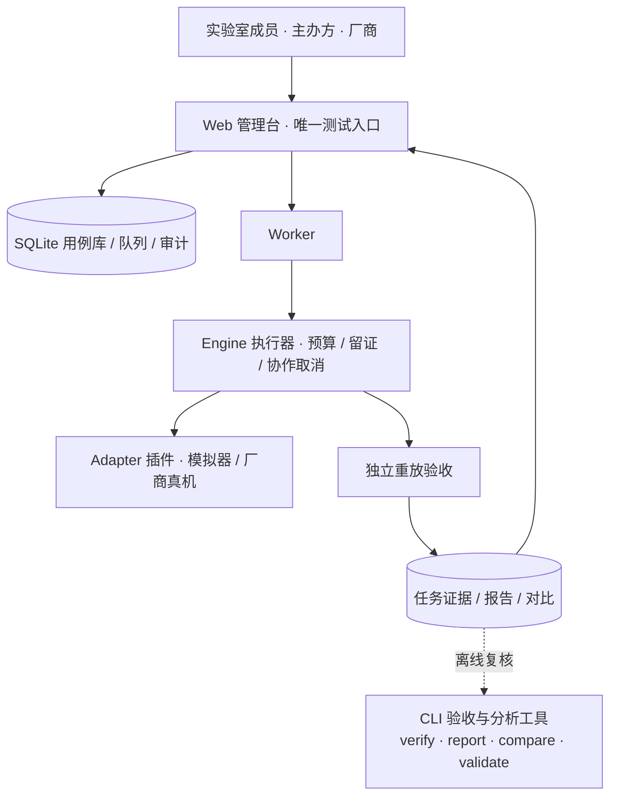

# 统一测试入口与分层指标体系建设方案

> 版本：v0.1 · 2026-11-09 · 状态：已评审通过，随 0.5.0 落地首批内容  
> 分支：`develop`。本文取代总体框架中"两种交付与执行流程"的双入口描述；证据优先、独立重放验收的原则不变。

## 1. 背景与目标

当前工具链存在三个结构性问题：

1. **测试入口分裂**：CLI 提供"主办方直连"和"厂商自测回传"两条执行路径，Web 管理台又保留了 organizer/vendor 执行模式选项。三方（主办方、厂商、实验室）实际都是同一套执行器与验收器，模式区分只增加了合同字段、页面选项和文档负担，没有带来隔离能力。
2. **指标层级不完整**：注册的 5 个基准中 4 个属于 L1/L2，框架文档定义的 L0（基础与运行能力）只有概念，没有任何可执行任务。用户关心的底层能力——门保真度、可支持的最大线路深度、可用率、漂移——无处产生。
3. **层级信息不可见**：Web 页面用 `kernel.*` 前缀判断"内核/场景算法"，层级是隐式约定而非数据。

本方案的目标：

- **单一测试入口**：所有测试执行只通过 Web 管理台；CLI 保留为"验收与分析"工具链（validate / verify / report / compare / templates / adapter-check / catalog），不再执行测试。
- **取消主办方/厂商双模式**：数据合同中移除 `mode` 字段，任务只区分"谁创建"（operator），不区分"以什么身份"。
- **建立 L0–L2 三层指标体系**：从底层设备能力（保真度、深度容量、可用性）到内核质量再到应用结果，同一次测试计划可混排三层任务，结果按层汇总。

## 2. 调研

### 2.1 内部现状

| 现状 | 出处 | 结论 |
| --- | --- | --- |
| L0 定义已有（控制/拓扑/读出、可用率、漂移、提交成功率、各阶段时间）但无实现 | toolchain-framework §5.1 | L0 需要可执行基准与遥测汇总两条腿 |
| K-GATE（门模型随机镜像/结构化参考电路）列为内核目标，未实现 | benchmark-proposal §7 | 镜像电路是 L0/L1 的公认做法，与现有 `gate.sample.v1` 能力直接兼容 |
| 执行证据已含逐作业状态、耗时、失败/取消，足以推导可用率与排队/执行时间 | engine 观测记录 | L0 遥测无需新采集，只需汇总视图 |
| suite 驱动的冻结-重放模型运行良好（5 个基准、指标注册表、Web 可视化） | benchmarks/metrics/web | 新增 L0 基准应沿用同一模型，避免另起炉灶 |

### 2.2 外部指标体系

| 体系 | 核心内容 | 对本项目的启示与限制 |
| --- | --- | --- |
| [Quantum Volume（Cross 等，2019）](https://arxiv.org/abs/1811.12926) | 方形电路宽度=深度，重输出频率置信超过 2/3 判定通过 | 单一数字、对大规模设备饱和；采纳"宽度×深度扫描"思想，不采纳单一 QV 值 |
| [镜像电路（Proctor 等，2022）](https://arxiv.org/abs/2006.11144) | 随机电路 + 逆电路，回到初态的成功概率估计整体保真度 | **首批 L0 采用**：不依赖校准数据访问、理想参考恒为 1、天然给出深度容量；电路由种子确定性生成，契合冻结重放 |
| [层保真度 LF / EPLG（McKay 等，2023）](https://arxiv.org/abs/2311.05933) | 交替执行 RB 序列测每层双比特门的错误率 | 需要序列级控制和 RB 机器；列为后续扩展，不进首批 |
| [随机基准 RB（Magesan 等，2010）](https://arxiv.org/abs/1009.3639) | Clifford 随机序列指数拟合门错误 | 同上；真机适配阶段与厂商校准流程对接后引入 |
| [QED-C 应用导向基准（2021）](https://arxiv.org/abs/2110.03137)（项目已引用） | 结果质量随宽度/深度的曲线 + 执行时间 | L0–L2 汇总视图的组织方式参考其"质量-规模-时间"三轴 |

### 2.3 选型结论

首批 L0 实现镜像电路基准 `capability.mirror_fidelity.v1`：种子确定的随机层（RZ/X 单比特门 + 环形相邻 CX）构造电路及其逆，在冻结的深度列表上逐深度测量回到初态的成功概率。它同时给出：

- **镜像成功概率随深度的衰减曲线**（整体保真度的代理量）；
- **最大稳定深度**：从浅到深连续达到冻结阈值（默认 ≥ 0.5，随机基线为 2⁻ⁿ）的最大深度——直接回答"可支持的最大量子线路深度"；
- 理想参考恒为 1（R1 级），本地模拟器与真机同一协议。

读出误差、校准快照（T1/T2、单/双比特门标称保真度）、RB/EPLG 属于需要设备侧数据访问能力的扩展，见 §6 路线图。

## 3. 目标架构

变更明细：

| 位置 | 变更 |
| --- | --- |
| `cli.py` | 删除 `run` / `plan` / `pack` / `export` 四个子命令；保留验收分析类命令 |
| `engine.run_suite` | 移除 `mode` 参数；运行摘要不再写 `mode`；`operator` 保留 |
| `engine.verify_files` | 不强制 `mode` 存在，旧证据（0.1.0–0.4.0）继续可验收；允许 0.5.0 |
| `web/store.py` | 任务输入不再接受/保存 `mode` |
| `web/worker.py` | 调用 `run_suite` 不传模式 |
| `web/app.js` | 任务表单删除"执行模式"下拉；层级标签改由基准注册表的 `layer` 字段驱动 |
| `report.py` / `compare.py` | 展示与来源记录容错读取 `mode`（旧报告仍有值，新报告为空） |
| 旧产物 | 0.4.0 及之前的运行目录、结果 ZIP、报告**不作任何改写**，仍可导入对比 |

## 4. 三层指标体系

| 层级 | 回答的问题 | 指标（方向） | 首批实现 |
| --- | --- | --- | --- |
| **L0 基础能力** | 设备能稳定执行多深的线路？门级质量如何？运行是否可靠？ | 最大稳定深度（越高越好）、镜像成功概率（越高越好）、逐深度衰减轨迹 | `capability.mirror_fidelity.v1`；可用率/耗时遥测复用既有观测记录（汇总视图列入路线图） |
| **L1 计算内核** | 固定内核任务执行得多准、多大规模？ | 占据数 MAE、TVD（越低越好）、关联/结构因子误差（越低越好）、碰撞概率（依任务） | `kernel.hamiltonian.v1`、`kernel.boson_fock.v1`、`application.material_dynamics.v1`（物理量重建属内核强化） |
| **L2 场景应用** | 完整求解流程交付什么结果、多少资源？ | 可行率/最优比（越高越好）、能量误差（越低越好）、训练轨迹与最终独立评估 | `application.mis.v1`、`application.vqe_toy.v1`；分类/真机应用在路线图 |

层级语义：L2 的用例可以依赖 L1 的能力声明；L0 指标用于解释上层表现，**三层各自报告，不合成总分**（与总体框架 §10 一致）。Web 用例库按层分组展示，任务结果按层归类，设备页（路线图）按层汇总成"设备能力档案"。

## 5. 首批实施内容（随 0.5.0）

1. **架构调整**（§3 全表）：CLI 入口收敛 + 双模式移除 + 兼容旧证据。
2. **镜像电路基准**：参数 `n_qubits`（2–8）、`depths`（升序、≤20 项、每项 1–50）、`circuit_seed`（0–2³¹−1）、`success_threshold`（0.5–1.0，默认冻结在套件实例里）。每深度 1 个作业；角色 `sweep:d={depth}`；电路生成严格由 `circuit_seed` 决定，重放可复现。
3. **指标注册**：`max_stable_depth`（主指标）、`mean_success_probability`、轨迹内 `success_probability`。
4. **Web 分层展示**：协议与用例卡片显示 L0 基础能力 / L1 内核 / L2 场景应用，取自基准注册表而非名称前缀。
5. **测试**：镜像电路理想参考恒等（任意深度成功概率≈1）、采样一致性、`max_stable_depth` 前缀判定、CLI 删除命令后的帮助与退出码、无 mode 合同的端到端重放、旧 mode 字段证据仍可验收。

验收标准：全量测试通过；旧 0.4.0 证据包与报告在 0.5.0 下验收/对比不回退；Web 上三层任务混排的任务可创建、执行、验收并按层展示。

## 6. 路线图（后续版本，不在本次范围）

| 项 | 依赖 |
| --- | --- |
| L0 遥测汇总：提交成功率、排队/执行/验收分段时间、跨任务漂移视图 | 既有观测记录聚合，无需新采集 |
| 读出与校准快照接入（T1/T2、标称门保真度，厂商自报标记来源） | 设备画像 schema + 厂商校准数据接口 |
| RB / EPLG 层保真度 | 序列级控制与厂商配合 |
| 宽度扫描（固定深度、递增宽度）与宽度×深度能力面 | 镜像基准扩展 |
| L2 分类场景（量子核 + SVM，冻结合成诊断集） | 数据划分冻结与经典基线 |
| 设备能力档案页（L0–L2 按层汇总） | 上述各项就绪后聚合 |
