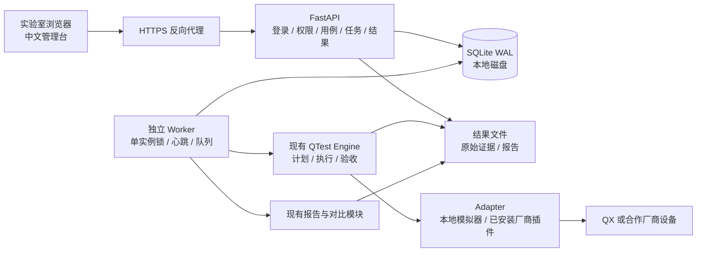
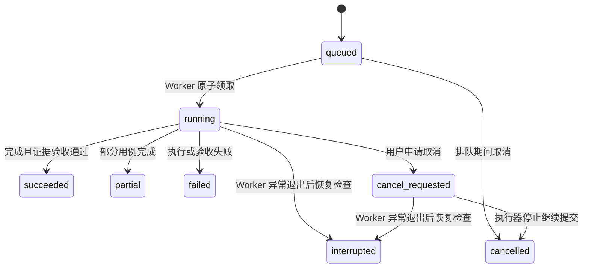

# QTest Web 管理台：调研与实施方案

日期：2026-11-05。部署目标：实验室内网、多人通过浏览器访问同一台测试服务器。

## 1. 调研结论与选型

现有 QTest 已有用例契约、设备 Adapter、执行器、证据验收、单机报告及综合对比。Web 层应调用这些模块，保持 CLI 与 Web 的算法、统计和证据规则一致。当前可执行协议为哈密顿模拟、Fock 玻色采样、MIS/QAOA、两量子比特模型 VQE 和一维 Ising 链材料动力学；真实分子、分类等扩展仍需实现对应协议。

| 决策 | 调研依据与本项目选择 |
|---|---|
| Python API 服务 | 采用 FastAPI，与现有 Python 包共用契约和校验；独立静态前端，不引入第二套算法实现。 |
| 独立 Worker | FastAPI 官方指出重计算可考虑独立进程/任务队列。量子任务还涉及长时间排队、持久化和取消，因此不使用 HTTP 请求或临时 BackgroundTasks 承载整次测试。[官方说明](https://fastapi.tiangolo.com/tutorial/background-tasks/) |
| SQLite WAL | 服务器本地 SQLite 保存元数据、任务及审计；短事务支持多人读取与串行写入。WAL 不适合把数据库放在网络共享盘，服务器扩展到多节点时迁移 PostgreSQL 与专用队列。[官方说明](https://sqlite.org/wal.html) |
| 账号与会话 | Argon2id 密码散列；随机服务端会话、HttpOnly/SameSite Cookie，HTTPS 部署启用 Secure；写请求要求同源及自定义请求头，登录同样保护。[密码](https://cheatsheetseries.owasp.org/cheatsheets/Password_Storage_Cheat_Sheet.html)、[会话](https://cheatsheetseries.owasp.org/cheatsheets/Session_Management_Cheat_Sheet.html)、[CSRF](https://cheatsheetseries.owasp.org/cheatsheets/Cross-Site_Request_Forgery_Prevention_Cheat_Sheet.html) |
| 前端 | 原生 HTML/CSS/JavaScript，同源 REST API，2 秒轮询活动页面。没有 CDN 依赖，安装后可在离线内网运行；首版暂不需要引入独立 Node 构建链。 |
| 部署 | Web 与 Worker 分开启动、分别管理。内网 HTTPS 反向代理统一入口；本机预览可使用回环地址 HTTP。厂商 SDK 与密钥仅放服务器。 |

以上选型是针对当前单服务器工具链的工程判断，不代表框架的通用性能排名。第一版只运行一个 Worker，依次执行任务，避免同时占用设备及本地参考计算资源；多人可同时创建用例、排队和浏览。

## 2. 页面与工作流

| 页面 | 第一版具体功能 |
|---|---|
| 总览 | 任务状态计数、最近任务、执行器心跳、设备能力与阻塞提示；明确模拟器/真实 QPU。 |
| 用例库 | 从五种协议模板新建，编辑名称/描述/shots/重复次数/协议参数，复制、归档/恢复；保存前复用严格参数校验，带版本号防止覆盖他人修改。 |
| 测试任务 | 选择多个用例、设备、随机种子和作业/shots/时间上限；预检显示能力缺项与资源数量；提交后冻结用例与设备快照。 |
| 任务详情 | 队列/执行/取消申请/成功/部分完成/失败/中断状态；重复实验进度、已提交作业数、资源量、当前厂商作业状态和事件记录；执行中明细表实时显示各重复已完成的主指标；可取消本人任务，管理员可取消所有任务。 |
| 测试结果 | 独立验收后按用例分组展示指标汇总表（各重复数值、均值、中位数、标准差，主指标高亮并标注单位与方向）、演化及训练轨迹折线图与验收概览；下载 Markdown、证据 JSON、结果 ZIP；取消和失败的证据保留。 |
| 综合对比 | 从已有可验收的任务选择结果，异步生成 Markdown/JSON/CSV；页面按可比条件组展示中文指标名、单位、方向、有效 n、统计量并标记组内观测最佳；不同种子或预算自动拆组，不形成跨技术路线总分。 |
| 系统管理 | 管理员创建/停用账号、分配角色；查看操作审计；对设备执行状态核实后解除阻塞。设备 SDK 注册与密钥维护走服务器命令行。 |

用例编辑器以通用字段表单与协议参数 JSON 结合，提供实际可运行的模板。新建用例不允许上传 Python 或任意执行脚本。共享实验室工作区中所有登录账号可查看结果；第一版不实现多组织数据隔离。

## 3. 架构

Web API 不直接连接硬件；Worker 根据管理员注册的设备 ID 加载已安装 Adapter。浏览器提交任务只能引用白名单设备，不能指定模块路径、命令或服务器文件路径。QX 与其他厂商真实接入仍需各自 SDK 插件。

## 4. 数据与状态约定

- `users / sessions`：账号、角色、停用状态及可撤销会话；会话有限期，登录限制尝试频率。
- `cases`：用例数据、名称、描述、归档状态、递增版本。旧任务保存自己的不可变快照。
- `devices`：公开描述、Adapter 名称、仅服务端可见的配置文件位置、启用状态、阻塞原因。
- `tasks`：测试或对比任务、创建人、幂等键、冻结输入、状态、时间与结果摘要；重复点击不重复创建。
- `events / audit`：执行事件和管理操作，均使用 UTC 存储，界面转换为访问者本地时间。
- `worker`：心跳；仅代表执行进程仍在线，不把心跳当作 QPU 仍在计算的证明。

`cancelled` 表示本工具停止推进任务；若外部作业已经提交，只能表示已申请取消，不能直接证明 QPU 停止。相关设备进入“待核实”阻塞，管理员查明厂商状态并填写说明后再放行。Worker 重启不自动重放运行中的任务；对未确认的设备暂停后续排队任务。重新执行由用户显式创建新任务。

首版运行进度为“已结束重复实验 / 计划重复实验”，并单独显示成功数，不能把已提交 shots 当作已完成 shots。任务无法验收时仍保留目录，但不展示为已验证结果。

## 5. 权限边界

| 操作 | 查看者 viewer | 测试员 operator | 管理员 admin |
|---|---|---|---|
| 查看设备、用例、任务、结果与下载 | 是 | 是 | 是 |
| 新建/编辑/归档用例，提交测试/对比 | 否 | 是 | 是 |
| 取消自己的任务 | 否 | 是 | 是 |
| 取消他人任务、解除设备阻塞 | 否 | 否 | 是 |
| 创建/停用账号及分配角色 | 否 | 否 | 是 |

首个管理员由服务器命令行交互创建，不设默认密码；SDK 配置文件不通过 API 返回。服务器管理员负责 HTTPS 证书、操作系统账户、数据目录访问控制及备份。

## 6. 实施顺序与验收

1. 完成本调研与设计文档，再开始编码。
2. 新增独立 Web 可选依赖、数据库/身份模块、任务 API 和命令入口。
3. 为现有执行器加入协作式取消与状态落盘；实现持久队列、Worker 单实例锁、重启恢复和设备阻塞。
4. 完成中文页面和任务/结果闭环，保持 CLI 用法兼容。
5. 自动测试覆盖权限、会话、非法参数、用例版本冲突、任务幂等、取消、Worker 重启、证据验收、报告与对比；回归原有测试。
6. 浏览器实际验证登录、新建用例、提交测试、查看进度/结果与下载；补充内网部署说明。

第一版交付是可运行的单服务器管理台；不承诺分布式调度、高可用、厂商通用驱动或未实现的科学协议。公网多租户、SSO、细粒度项目权限和多 Worker 设备并行列为后续扩展。
